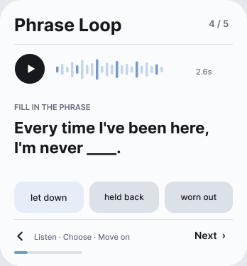
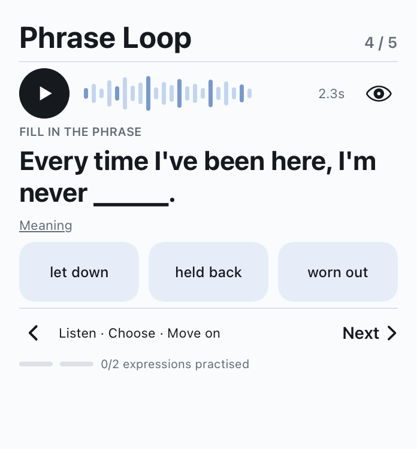

# Design evolution and media provenance

## The design problem

The first widget made the loop usable: play, choose, see feedback, and advance. V2 gives the sentence and audio a clearer hierarchy while separating a recognized answer from an independently recalled expression.

The interface was developed from existing Figma frames into the project's native SwiftUI component. The illustration below compares the actual Figma frame with the native rendering; it is not a pair of device screenshots.

  
  

**Figma reference → native implementation.** The implementation removes the design's highlighted unanswered option, avoiding a visual hint. It uses actual excerpt duration, preserves the full sentence, and adds explicit meaning and recall controls. The audio bars are a visual motif, not a live waveform.

## Decisions carried into the build

- Give the sentence priority; keep secondary labels quiet.
- Use distinct correct and incorrect feedback, with a retry path.
- Count distinct expressions practiced; do not equate recognition with speaking ability.
- Preserve WidgetKit's real margins and corner treatment instead of forcing a Figma artboard onto the Home Screen.
- Adapt typography and spacing for longer sentences; test compact layouts separately.

## Image sources

Reviewed on November 10, 2026.

| Files | Evidence | Treatment |
| :--- | :--- | :--- |
| `assets/native-listen.png`, `native-correct.png`, `native-recall.png` | Actual SwiftUI simulator component renderings retained with the successful Build 5 validation | Copied unchanged; explicitly labeled as simulator renderings |
| `assets/figma-listen.png` | Cached original Figma frame from the project's V2 design review | Copied unchanged; explicitly labeled as a design reference |
| `assets/v1-iphone-widget.png` | User-provided real iPhone screenshot, November 8, 2026; first native widget's correct-answer state | Cropped to the widget; personal surroundings and image metadata excluded |
| `assets/v2-iphone-widget.png` | User-provided real iPhone screenshot, November 8, 2026; V2 widget with a reported audio failure | Cropped to the widget; the failure message is preserved |

These are existing product images. No AI interface, invented device capture, altered success indicator, or fabricated learning history is included. The iPhone comparison shows the earlier releases, not an acceptance capture of Build 5.

Image metadata was removed from all published PNG copies without changing their pixels.

## Public repository boundary

Only selected documentation and images are published. No source tree, private Git history, audio excerpts, learning database, feed URL, signing materials, or internal configuration are included. Short phrases visible in interface screenshots serve to document the product; no rights to the underlying media are granted.

This is a private-software product showcase. It grants no open-source license to the application or learning content. Product branding and third-party platform elements remain the property of their respective owners.
