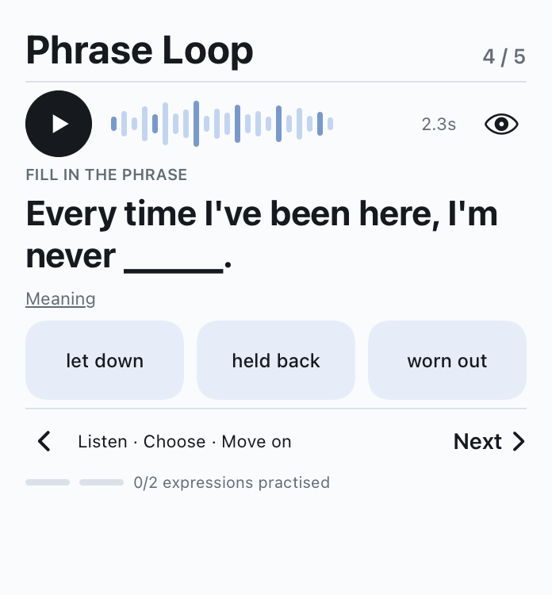
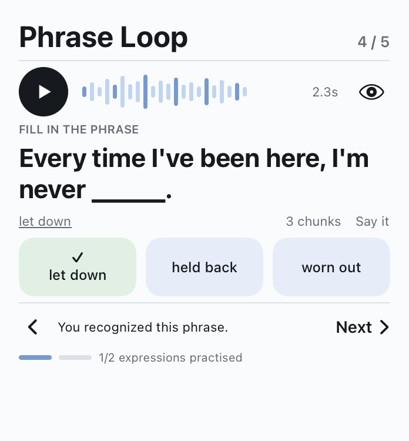
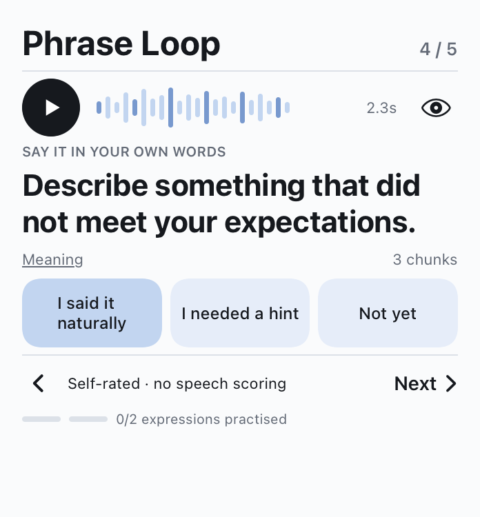
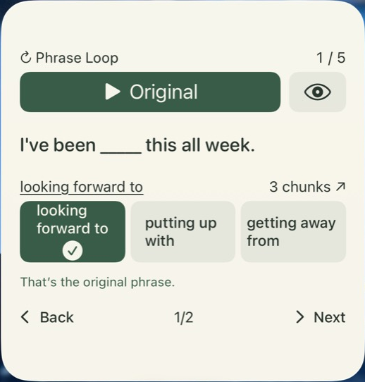
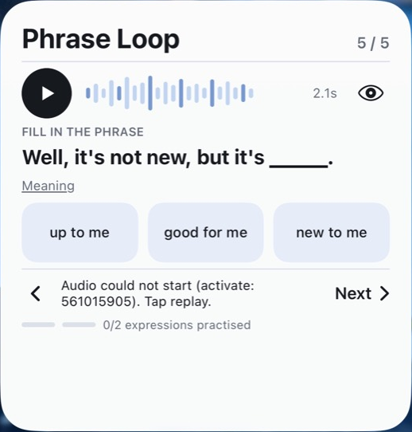

<h1 align="center">Phrase Loop</h1>

<strong>Turn a familiar phrase into something you can say.</strong>

Native iOS learning app + interactive Home Screen widget 
Designed and independently developed by <a href="https://github.com/annikazhang77">Annika Zhang</a>

<strong>In Active Development</strong> 
Private internal TestFlight · Not released on the App Store

---

Recognizing a phrase is easier than recalling it in conversation. Phrase Loop brings a short practice loop to the iPhone Home Screen: listen to an original clip, choose the missing phrase, and move toward saying it without a prompt.

The product explores how a small, repeatable interaction can make language practice easier to return to—without opening a full lesson every time.

  
  
  

Listen → recognize → recall. Real SwiftUI simulator renderings from the latest Build 5 validation; these are component captures, not iPhone Home Screen screenshots.

## A small loop with a clear purpose

- **Listen in context.** Replay an original audio excerpt, reveal the full sentence, or ask for the phrase's meaning.
- **Recognize, then retrieve.** Choose among three answers, get immediate feedback, and continue into recall or optional three-chunk reconstruction.
- **Keep progress honest.** Recognition and independent output are different evidence. A Tiny Win counts two distinct expressions practiced, rather than claiming fluency from a correct tap.
- **Stay close to the Home Screen.** A large interactive WidgetKit widget exposes the core loop; the companion app supports deeper practice and content management.

## From first prototype to V2

  
  

Before / after — actual iPhone captures, November 8, 2026. Cropped to the widget to exclude personal wallpaper, notifications, and other apps.

V2 introduced a stronger editorial hierarchy: a larger sentence, a focused audio control, quieter supporting labels, and separate progress for distinct expressions. Existing Figma frames informed the SwiftUI implementation; feedback, long-text handling, and recall controls were adapted to real widget constraints.

The V2 device capture also records an audio-session failure. That finding led to the latest repair candidate; the acceptance status below keeps the unresolved behavior explicit. [Design notes and media sources →](DESIGN.md)

## What works, and what is still being verified

Status reviewed **November 10, 2026**. Latest internal candidate: **0.6.0, Build 5**.

| Evidence level | Current state |
| :--- | :--- |
| **Confirmed on iPhone** | Native widget installation, answer selection, correct-answer feedback, and the progress counter. Original Home Screen audio worked in an earlier Build 2; the V2 interface and foreground app audio were also observed on device. |
| **Implemented and tested** | Native app/widget compilation; listen, feedback, recall, chunk, and long-text layouts; local shared persistence; adaptive review logic; backup/restore; simulator audio-player lifecycle. Latest validation: 17 tests passed, one external real-export test explicitly skipped, and 16 native layout checks passed. |
| **Current device gate** | Build 4 regressed Home Screen audio. Build 5 reached private internal TestFlight with a repair, but its Home Screen playback has **not yet been verified on a real iPhone**. Earlier audio success does not establish that this candidate works. |
| **Further device acceptance** | Repeated playback, cold launch, offline behavior, next-day persistence, and the full Tiny Win flow need individual confirmation on the current build. |

## Built with

| Layer | Implementation |
| :--- | :--- |
| Interface | Swift and SwiftUI; design iterations in Figma |
| Home Screen | WidgetKit and App Intents, including an audio playback intent |
| Audio | AVFoundation and AVAudioPlayer |
| Storage | Local JSON, shared through an App Group; Keychain for optional private-feed credentials |
| Validation and delivery | XCTest / Swift Testing, simulator checks, Xcode, and private internal TestFlight |

## Next

Verify Build 5 playback through the real Home Screen, complete the remaining device acceptance checks, and refine the balance between recognition and independent recall. An optional content-feed path is implemented; a live feed has not been configured, so automatic new-phrase delivery is not presented as a working feature.

---

Product and design showcase by <a href="https://github.com/annikazhang77">Annika Zhang</a>. Application source, original audio, private learning history, credentials, and internal configuration remain private. This repository does not distribute a runnable app or a learning-content library.
